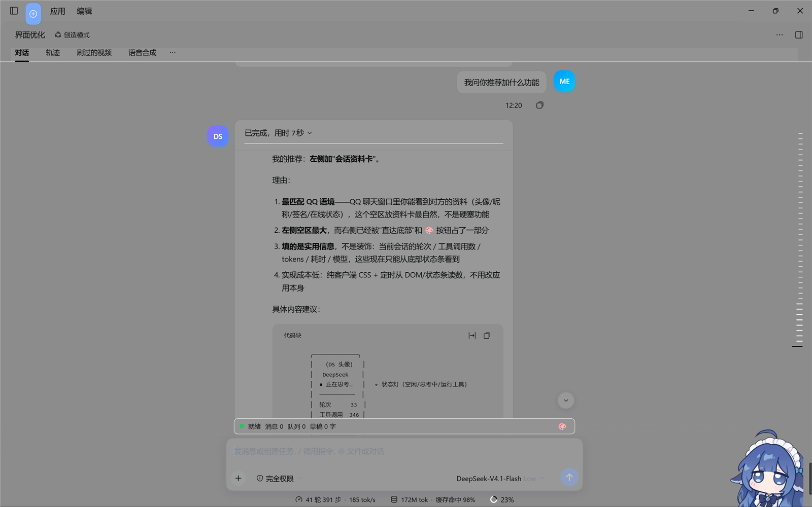

# dsh-ui-boost —— DSH Web 界面增强

DSH Web 界面的常驻优化插件（持久客户端插件，非会话动态插件，重启自动加载）。



## 功能

### QQ 聊天模式
- **气泡布局**：助手左侧、用户右侧，渐变圆形头像（DS / ME）
- **一轮对话一个气泡**：同一回合的多段输出合并为连续气泡，只描外轮廓、无内部接缝
- **用户消息**：原生灰色底、单层气泡（内层文字气泡已透明化），图片与文字同处一个气泡
- **白描边输入框**：输入区圆角卡片 + 白色描边 + 内高光
- **联系人式侧栏**：工作区圆形头像、会话行加高、新会话蓝色主按钮、顶部标签栏悬停/选中优化

### 会话大纲（右侧）
- 替代原生回合刻度条，列出每个提问：`【问题前5字…|时间】`
- **点击跳转**该轮；滚动时**当前阅读位置高亮**（对比色描边）
- **悬停显示完整问题**；标题可**折叠/展开**
- 仅在「对话」视图、宽度 ≥1400px、右侧边栏关闭时显示

### RGB 调色
- R/G/B 滑杆 + 强度，基于主题 token 重着色（非混合层）：背景/卡片/代码块/diff/气泡/输入框/菜单浮层等表面按调色混合
- **文字取调色的反色**，并提供「文字柔和」滑杆（反色向原文字色混合，默认 35%）
- 大纲/侧栏/顶部等面板：**同色相浅色调**，跟随调色但比界面浅一档
- 输入区控件描边、占位文字、@ 引用文字均从实际底色推导，保证可读

### 其他
- **Tool 卡片默认折叠**：工具调用默认只显示一行摘要，点击展开
- **输入区状态条**：运行状态、消息数、队列数、草稿字数、预计 token
- **🎨 设置面板**：从输入框上方按钮向上展开；设置自动保存到 `~/.dsh/ui-boost.json`

## 安装 / 升级

```sh
# 本地开发安装（pnpm link 协议）
dsh plugin --profile web add link:D:\dsh\ui-boost

# 升级（代码改动后重新执行一次即可刷新链接内容）
dsh plugin --profile web add link:D:\dsh\ui-boost

# 卸载
dsh plugin --profile web remove dsh-ui-boost
```

装好后**重启 web 进程 / 硬刷新页面**生效（客户端 bundle 带 immutable 缓存，普通刷新可能仍是旧代码）。

## 结构

| 文件 | 作用 |
| --- | --- |
| `cordis.patch.yml` | bundle 挂载声明（把 `dsh-ui-boost` 行插入 web profile 配置树） |
| `lib/index.js` | node 半端：设置 API（`/ui-boost/settings.json`） |
| `lib/client.js` | 浏览器半端：样式、调色、气泡分组、会话大纲、面板 UI |

## 注意

- 大量样式依赖 DSH 运行版的哈希类名（`LOmM4q_*`、`xMeOpW_*`、`wtg9ga_*`、`wnFoaW_*`、`an3WzG_*`、`SNx2jG_*`、`_6XhDDa_*`、`NOA9Ua_*` 等）；
  DSH 前端大版本升级后若类名变化，需同步更新 `lib/client.js`。
- 调色基于主题 token 在 `body` 上的 inline 覆盖，关闭调色或卸载插件时会自动清除，不污染主题。
